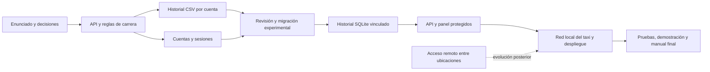

# Mapa de contexto de TaxiRoute

Última revisión: 15 de noviembre de 2026. Es una guía de entrada; antes de actuar, comprueba la rama, los cambios y el estado real de Docker y de las pruebas.

## Situación en una mirada

- **Objetivo:** taxímetro formativo en Python con historial, acceso protegido y web adaptable. El enunciado está en [ENUNCIADO.md](ENUNCIADO.md).
- **Ramas:** las fases 1 y 2 están integradas según el README; la fase 3 se cerró como demostración académica local. La fase 4 se desarrolla en `feature/fase-4-produccion`.
- **Instalación:** se ha trasladado la instalación propia a una composición LAN con Docker. Una copia nueva se comprobó antes del cambio; cuentas, historial, códigos de recuperación y tarifas coinciden en el destino. Las sesiones anteriores se revocaron. El correo autorizado se ha cargado; la autenticación real en el destino está pendiente de confirmación. La instalación anterior y su copia permanecen conservadas y el lanzador anterior está bloqueado. No hay recuperación integral ni homologación para cobros.
- **Red:** la composición LAN de la instalación propia responde por HTTPS desde el ordenador. Se ha preparado una autoridad local y los dos dispositivos han confirmado la página de prueba sin advertencias. Falta confirmar el acceso autenticado y el recorrido de la instalación propia desde los dispositivos. La clave privada de la autoridad permanece fuera de Docker. El lanzador `iniciar-taxiroute-red.cmd` reutiliza una instalación ya configurada; Gmail requiere `--conectar-gmail`.
- **Certificados:** se ha instalado la autoridad local en el móvil y la tablet; ambos han confirmado una página de prueba sin advertencias. La validación del acceso autenticado a la instalación propia sigue pendiente.
- **Recuperación:** se han probado interrupciones de carreras ficticias y revisión del último punto fiable. Las copias/restauraciones y los comprobantes de cierre siguen siendo experimentales; no acreditan recuperación completa de datos reales.
- **Actualización:** se ha trasladado la instalación propia a LAN, conservando copia y origen e invalidando sesiones anteriores. La barrera bloquea el lanzador anterior, pero no procesos externos ni Docker directo. Los CSV históricos y el registro de actividad permanecen en origen. La recuperación tras interrupciones, la actualización de imagen y la coordinación con procesos externos tienen limitaciones pendientes.
- **Cierre y migración:** un comprobante interno y una migración v14→v15 se prueban por separado. Ninguno está conectado a la API ni al lanzador; no migrar datos reales antes de coordinar imagen, base, copia y pruebas de interrupción. El cierre actual no tiene reintento idempotente completo.
- **Docker:** la instalación propia de red se ha iniciado y se ha verificado HTTPS. Antes de detenerla, comprueba que no hay carreras ni operaciones pendientes; evita arrancar la instalación anterior por mecanismos ajenos al lanzador.
- **Pruebas:** consulta GitHub Actions y los resultados de la revisión concreta antes de afirmar que una versión pasa. El detalle histórico y los límites están en [ESTADO_ENTREGA.md](ESTADO_ENTREGA.md).

## Decisiones que condicionan el trabajo

- Interfaz local, adaptable y accesible. El acceso desde la red del taxi es requisito de fase 4; el acceso desde ubicaciones distintas y la sesión única por cuenta se dejaron para una evolución posterior.
- La entrega y demostración deben quedar preparadas en Docker. La demo actual usa exclusivamente datos ficticios; el despliegue protegido real sigue pendiente.
- Varias cuentas con roles; el administrador también puede conducir. Las tarifas se fijan al iniciar cada carrera y los cambios se aplican a carreras nuevas.
- Al interrumpirse una carrera, se revisa el último punto fiable y no se cobra automáticamente el intervalo desconocido. Cerrar sesión no finaliza la carrera. Para desactivar una cuenta con carrera o acción pendiente, primero se pide finalizarla o revisarla.
- El historial de fase 3 se conserva en CSV por cuenta. La fase 4 migra a SQLite sin inventar propietarios ni borrar los CSV. Una cuenta sin CSV requiere revisión individual explícita de un administrador y registro de la decisión.
- El asistente de migración, la transición y la recuperación siguen siendo experimentales. Se han probado con datos temporales y el asistente en una terminal interactiva de Windows; no se ha validado su procedimiento con datos reales ni en Git Bash. La web anterior sin cuentas no es la web protegida.
- La entrega incluye documentación técnica, repositorio, tablero, demostración y manual de usuario final basado en lo comprobado. No afirmar que una función experimental está lista para uso real.

## Mapa de fuentes

| Necesidad | Fuente principal |
| --- | --- |
| Cómo colaborar y límites del proyecto | [AGENTS.md](AGENTS.md) |
| Requisitos y fases | [ENUNCIADO.md](ENUNCIADO.md) |
| Estado, pruebas y límites | [ESTADO_ENTREGA.md](ESTADO_ENTREGA.md) |
| Instalación y uso de las demos | [README.md](README.md) |
| Migración y decisiones de fase 4 | [DISENO_MIGRACION_FASE_4.md](DISENO_MIGRACION_FASE_4.md) |
| Contrato y límites de la API | [API_EXPERIMENTAL.md](API_EXPERIMENTAL.md) |
| Cuentas, permisos y recuperación | [DISENO_CUENTAS.md](DISENO_CUENTAS.md) · [DISENO_RECUPERACION.md](DISENO_RECUPERACION.md) |
| Plan de tareas | [Tablero de TaxiRoute](https://github.com/users/ivanmartinezsanchez/projects/2) |

## Grafo de dependencias

## Retomar sin releer todo

1. Lee este mapa y [AGENTS.md](AGENTS.md); después consulta solo las fuentes relacionadas con la tarea actual.
2. Comprueba `git status`, la rama, el último cambio y las pruebas relevantes. El mapa es una instantánea y no sustituye esa verificación.
3. Diferencia lo solicitado, lo aprobado, lo implementado y lo probado. Mantén los historiales y credenciales reales fuera de las pruebas.
4. Para decisiones ordinarias, avanza; consulta las que cambien sustancialmente seguridad, datos, arquitectura, coste o experiencia. Explica brevemente los avances y mantén la redacción natural en español.
5. Actualiza el mapa y el tablero cuando corresponda, sin volcar conversaciones completas ni incluir contraseñas, tokens, PIN, claves o información privada.
