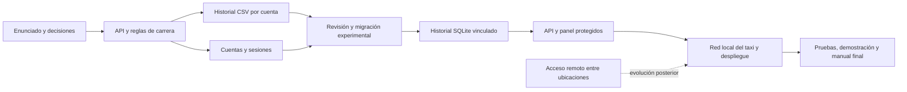

# Mapa de contexto de TaxiRoute

Última revisión: 15 de noviembre de 2026. Es una guía de entrada; antes de actuar, comprueba la rama, los cambios y el estado real de Docker y de las pruebas.

## Situación en una mirada

- **Objetivo:** taxímetro formativo en Python con historial, acceso protegido y web adaptable. El enunciado está en [ENUNCIADO.md](ENUNCIADO.md).
- **Ramas:** las fases 1 y 2 están integradas según el README; la fase 3 se cerró como demostración académica local. La fase 4 se desarrolla en `feature/fase-4-produccion`.
- **Instalación:** hay un lanzador experimental con proxy, Docker, SQLite, cuenta propia y Gmail autorizado. En Windows, si `.venv` no existe, lo prepara con Python 3.13 y las dependencias; no instala Python y no cambia un entorno existente. El acceso administrativo se comprobó; no se considera una instalación lista para datos o cobros reales. La imagen registrada se reutiliza y no se actualiza por hacer `git pull`.
- **Red:** una instancia Docker ficticia separada se probó desde un móvil Android en la misma Wi-Fi: acceso de conductor, carrera, cambios de estado, cierre e historial. Se utilizó un certificado autofirmado. No se probó tablet; quedan pendientes confianza TLS e integración de la instalación final. Existe una identidad LAN separada que guarda IP y puerto; una comprobación interna contrasta identidad, certificados y contenedores con Docker simulado. La generación de certificados admite la IP privada. Hay un primer arranque LAN separado que comprueba la IP del equipo, certificados y contenedores y registra la identidad. Se ha probado en Docker real desde el propio ordenador con HTTPS verificado y datos ficticios: acceso de conductor, inicio, movimiento, cierre y consulta de una carrera, además del rechazo administrativo sin sesión. No se ha probado desde móvil o tablet en este arranque, no está conectado al lanzador principal. Existe una carga explícita de correo para red probada con credenciales y Docker simulados, sin conexión al lanzador ni validación para datos reales. La reutilización LAN se ha probado con contenedores ficticios y Docker real: comprueba el puerto efectivo del backend antes de iniciar el proxy y verifica HTTPS. Existe un comando de reutilización LAN, probado en Docker con datos ficticios sin Gmail; la opción explícita de correo solo se ha probado con simulaciones. Las inspecciones y bloqueos son cooperativos y sigue pendiente resolver la concurrencia de datos y validar el acceso de la instalación propia.
- **Certificados:** el servidor comprueba vigencia y dirección en los modos indicados en [ESTADO_ENTREGA.md](ESTADO_ENTREGA.md). Se probó una autoridad temporal en el ordenador, sin instalarla en Android; el usuario prefirió dejar esa instalación pendiente.
- **Recuperación:** se han probado interrupciones de carreras ficticias y revisión del último punto fiable. Las copias/restauraciones y los comprobantes de cierre siguen siendo experimentales; no acreditan recuperación completa de datos reales.
- **Actualización:** hay una comprobación interna de precondiciones para servicios detenidos, sin carreras ni operaciones pendientes; todavía no sustituye imágenes ni coordina procesos externos. La instalación activa reutiliza su imagen anterior. Se ha preparado un flujo local a LAN que bloquea el arranque anterior, copia cuentas/historial/tarifas e invalida sesiones en el destino. Ha superado pruebas con datos ficticios y un ensayo integral con Docker real y HTTPS; la instalación ficticia anterior quedó bloqueada. Ante un fallo capturado antes de intentar publicar, se ha probado con datos ficticios la retirada de la barrera tras comprobar integridad y servicios detenidos. En la instalación LAN aislada se ha comprobado acceso administrativo con un único código enviado por Gmail y una cuenta ficticia. No trasladar datos reales: faltan recuperación tras interrupciones o publicación y confianza TLS en dispositivos. Los CSV históricos y actividad permanecen en origen; el bloqueo no impide procesos externos o Docker directo.
- **Cierre y migración:** un comprobante interno y una migración v14→v15 se prueban por separado. Ninguno está conectado a la API ni al lanzador; no migrar datos reales antes de coordinar imagen, base, copia y pruebas de interrupción. El cierre actual no tiene reintento idempotente completo.
- **Docker:** se inició Docker Desktop, se comprobó que la instancia ficticia del certificado estaba detenida y se reabrió la instalación local con el perfil Gmail autorizado, sin enviar correo. Verifica siempre el estado actual antes de modificar servicios o publicar puertos.
- **Pruebas:** consulta GitHub Actions y los resultados de la revisión concreta antes de afirmar que una versión pasa. El detalle histórico y los límites están en [ESTADO_ENTREGA.md](ESTADO_ENTREGA.md).

## Decisiones que condicionan el trabajo

- Interfaz local, adaptable y accesible. El acceso desde la red del taxi es requisito de fase 4; el acceso desde ubicaciones distintas y la sesión única por cuenta se dejaron para una evolución posterior.
- La entrega y demostración deben quedar preparadas en Docker. La demo actual usa exclusivamente datos ficticios; el despliegue protegido real sigue pendiente.
- Varias cuentas con roles; el administrador también puede conducir. Las tarifas se fijan al iniciar cada carrera y los cambios se aplican a carreras nuevas.
- Al interrumpirse una carrera, se revisa el último punto fiable y no se cobra automáticamente el intervalo desconocido. Cerrar sesión no finaliza la carrera. Para desactivar una cuenta con carrera o acción pendiente, primero se pide finalizarla o revisarla.
- El historial de fase 3 se conserva en CSV por cuenta. La fase 4 migra a SQLite sin inventar propietarios ni borrar los CSV. Una cuenta sin CSV requiere revisión individual explícita de un administrador y registro de la decisión.
- El asistente de migración, la transición y la recuperación siguen siendo experimentales. Se han probado con datos temporales y el asistente en una terminal interactiva de Windows; no se ha validado su procedimiento con datos reales ni en Git Bash. La web anterior sin cuentas no es la web protegida.
- La entrega incluye documentación técnica, repositorio, tablero, demostración y manual de usuario final basado en lo comprobado. No afirmar que una función experimental está lista para uso real.

## Mapa de fuentes

| Necesidad | Fuente principal |
| --- | --- |
| Cómo colaborar y límites del proyecto | [AGENTS.md](AGENTS.md) |
| Requisitos y fases | [ENUNCIADO.md](ENUNCIADO.md) |
| Estado, pruebas y límites | [ESTADO_ENTREGA.md](ESTADO_ENTREGA.md) |
| Instalación y uso de las demos | [README.md](README.md) |
| Migración y decisiones de fase 4 | [DISENO_MIGRACION_FASE_4.md](DISENO_MIGRACION_FASE_4.md) |
| Contrato y límites de la API | [API_EXPERIMENTAL.md](API_EXPERIMENTAL.md) |
| Cuentas, permisos y recuperación | [DISENO_CUENTAS.md](DISENO_CUENTAS.md) · [DISENO_RECUPERACION.md](DISENO_RECUPERACION.md) |
| Plan de tareas | [Tablero de TaxiRoute](https://github.com/users/ivanmartinezsanchez/projects/2) |

## Grafo de dependencias

## Retomar sin releer todo

1. Lee este mapa y [AGENTS.md](AGENTS.md); después consulta solo las fuentes relacionadas con la tarea actual.
2. Comprueba `git status`, la rama, el último cambio y las pruebas relevantes. El mapa es una instantánea y no sustituye esa verificación.
3. Diferencia lo solicitado, lo aprobado, lo implementado y lo probado. Mantén los historiales y credenciales reales fuera de las pruebas.
4. Para decisiones ordinarias, avanza; consulta las que cambien sustancialmente seguridad, datos, arquitectura, coste o experiencia. Explica brevemente los avances y mantén la redacción natural en español.
5. Actualiza el mapa y el tablero cuando corresponda, sin volcar conversaciones completas ni incluir contraseñas, tokens, PIN, claves o información privada.
