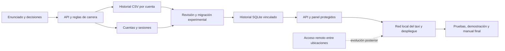

# Mapa de contexto de TaxiRoute

Última revisión: 11 de noviembre de 2026. Es una guía de entrada, no una garantía de que el código o el tablero no hayan cambiado. Antes de actuar, comprueba la rama, los cambios sin guardar y las fuentes indicadas; actualiza este mapa cuando cambie una decisión, un estado o un enlace importante.

## Situación en una mirada

- **Objetivo:** taxímetro en Python para un proyecto formativo, con historial, acceso protegido e interfaz web adaptable. El enunciado está en [ENUNCIADO.md](ENUNCIADO.md).
- **Plazo indicado:** 15 de noviembre de 2026. Priorizar requisitos de las fases 3 y 4 y la entrega; confirmar si el plazo cambia.
- **Rama de trabajo observada:** `feature/fase-4-produccion`. La fase 3 se conservó en `feature/fase-3-web-local`; comprueba la rama real y las integraciones antes de modificarlas.
- **Fases 1 y 2:** integradas según el README. **Fase 3:** cerrada como demostración académica local, no como instalación de producción. Por decisión del proyecto no se hará prueba física en tablet para esta entrega.
- **Fase 4:** en curso. Ya existen una transición y un asistente de migración experimentales, API y panel de demostración; faltan su integración y validación como instalación final, el acceso seguro por la red del taxi y el despliegue con un comando.
- **Última comprobación consultada:** el flujo de GitHub Actions de `ea0c869` finalizó correctamente en Windows, Linux y macOS; consulta las ejecuciones actuales antes de afirmar que una versión nueva pasa.

## Decisiones que condicionan el trabajo

- Interfaz local, adaptable y accesible. El acceso desde la red del taxi es requisito de fase 4; el acceso desde ubicaciones distintas y la sesión única por cuenta se dejaron para una evolución posterior.
- Varias cuentas con roles; el administrador también puede conducir. Las tarifas se fijan al iniciar cada carrera y los cambios se aplican a carreras nuevas.
- Al interrumpirse una carrera, se revisa el último punto fiable y no se cobra automáticamente el intervalo desconocido. Cerrar sesión no finaliza la carrera. Para desactivar una cuenta con carrera o acción pendiente, primero se pide finalizarla o revisarla.
- El historial de fase 3 se conserva en CSV por cuenta. La fase 4 migra a SQLite sin inventar propietarios ni borrar los CSV. Una cuenta sin CSV requiere revisión individual explícita de un administrador y registro de la decisión.
- El asistente de migración, la transición y la recuperación siguen siendo experimentales. Se han probado con datos temporales y el asistente en una terminal interactiva de Windows; no se ha validado su procedimiento con datos reales ni en Git Bash. La web anterior sin cuentas no es la web protegida.
- La entrega incluye documentación técnica, repositorio, tablero, demostración y manual de usuario final basado en lo comprobado. No afirmar que una función experimental está lista para uso real.

## Mapa de fuentes

| Necesidad | Fuente principal |
| --- | --- |
| Cómo colaborar y límites del proyecto | [AGENTS.md](AGENTS.md) |
| Requisitos y fases | [ENUNCIADO.md](ENUNCIADO.md) |
| Estado, pruebas y límites | [ESTADO_ENTREGA.md](ESTADO_ENTREGA.md) |
| Instalación y uso de las demos | [README.md](README.md) |
| Migración y decisiones de fase 4 | [DISENO_MIGRACION_FASE_4.md](DISENO_MIGRACION_FASE_4.md) |
| Contrato y límites de la API | [API_EXPERIMENTAL.md](API_EXPERIMENTAL.md) |
| Cuentas, permisos y recuperación | [DISENO_CUENTAS.md](DISENO_CUENTAS.md) · [DISENO_RECUPERACION.md](DISENO_RECUPERACION.md) |
| Plan de tareas | [Tablero de TaxiRoute](https://github.com/users/ivanmartinezsanchez/projects/2) |

## Grafo de dependencias

## Retomar sin releer todo

1. Lee este mapa y [AGENTS.md](AGENTS.md); después consulta solo las fuentes relacionadas con la tarea actual.
2. Comprueba `git status`, la rama, el último cambio y las pruebas relevantes. El mapa es una instantánea y no sustituye esa verificación.
3. Diferencia lo solicitado, lo aprobado, lo implementado y lo probado. Mantén los historiales y credenciales reales fuera de las pruebas.
4. Para decisiones ordinarias, avanza; consulta las que cambien sustancialmente seguridad, datos, arquitectura, coste o experiencia. Explica brevemente los avances y mantén la redacción natural en español.
5. Actualiza el mapa y el tablero cuando corresponda, sin volcar conversaciones completas ni incluir contraseñas, tokens, PIN, claves o información privada.
